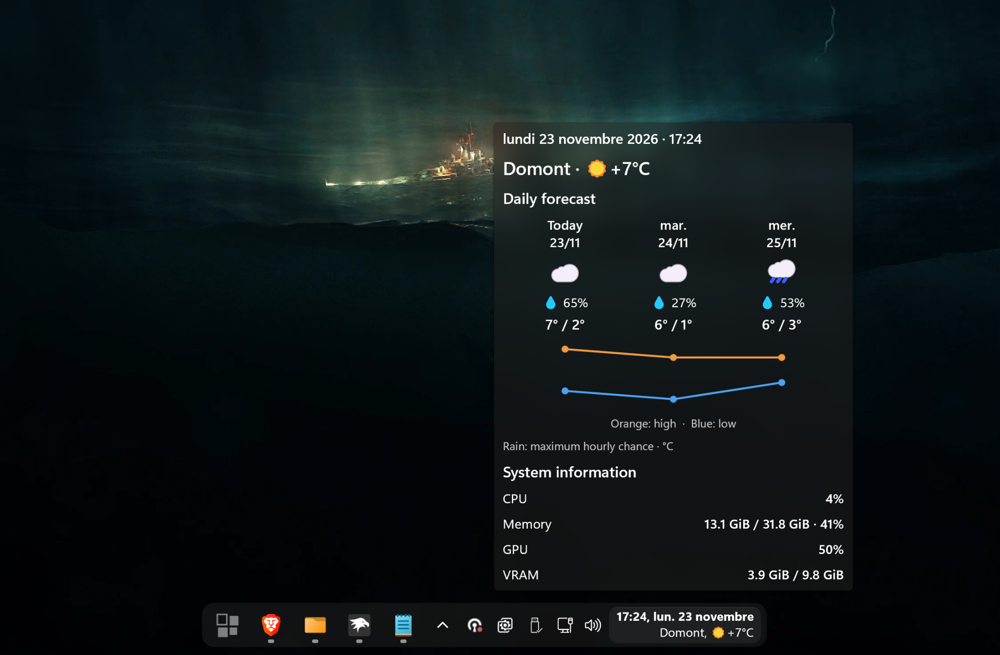
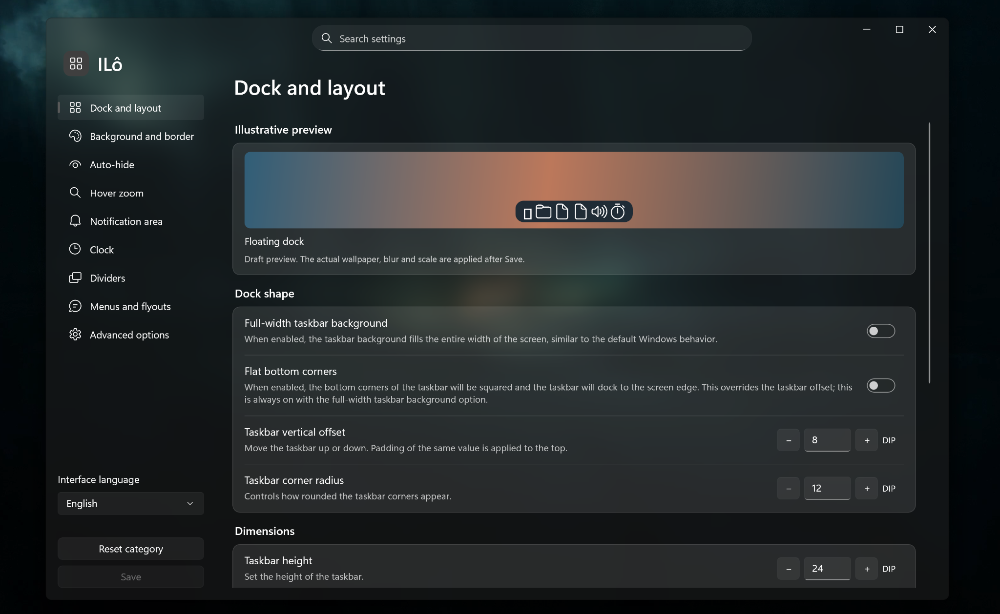
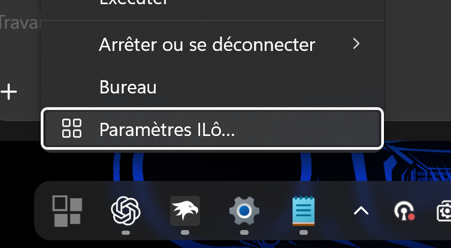

# ILô 2.0.2

## English

[Dock changelog](CHANGELOG.md#english) · [Latest release](https://github.com/luke95330/ILo/releases/latest)

### What's new in ILô 2.0.2

- Improved assisted update installation: the **Copy source and open Windhawk** button copies the verified source and opens the installed Windhawk application.
- Clear feedback immediately below the button, with instructions to update and compile the existing ILô mod and a fallback if Windhawk cannot be opened automatically.
- Update controls now appear before the release notes. SHA-256 verification and existing ILô profiles are preserved.

ILô turns the Windows 11 taskbar into a floating dock that centers your apps and system tray together. Icons can magnify on hover, and you can customize spacing, rounded corners, blur, and transparency. Adapted by Mighty-Luke and tested on Windows 11 build 26300.10075 with Windhawk 1.7.3.

### Settings panel

Right-click **Start** or an empty area of the taskbar and select **ILô settings…**. Search across nine settings categories or select one in the sidebar. Select **Save** to apply your changes. **Reset category** restores the selected category to its Windhawk settings. The panel uses the dock’s background settings and remembers its window size.

Choose **English** or **Français** under **Interface language** at the bottom of the sidebar. The panel switches immediately and remembers your choice. The ILô command in the Start and taskbar context menus uses the same language the next time you open them. English is the default and fallback.

[View the settings panel](assets/ilo-settings-2.png) · [View the Start context menu](assets/ilo-start-menu.png) (French interface)

The optional [ILô Media player](https://github.com/luke95330/ILo_Media) adds album art and playback controls to the dock.

### Installation

Disable your previous dock mod. In Windhawk, create a local mod, paste [ilo.wh.cpp](ilo.wh.cpp) into the editor, and compile it. Open the mod’s **Settings** tab to customize the dock.

To update an existing installation, use **About → Check for updates → Download and verify**, then **Copy source and open Windhawk**. Edit the existing ILô mod, select all, paste the verified source and compile; do not create a second ILô instance.

### Sources

Edit [ilo.wh.cpp](ilo.wh.cpp), then run `python assemble-mod.py` to update the two historical distribution files. The `mod-parts` directory contains the source files from the original fork.

ILô is based on [vitaliiorlov’s fork](https://github.com/vitaliiorlov/windhawk-taskbar-centered-condensed) of [DarkionAvey’s TAI](https://github.com/DarkionAvey/windhawk-taskbar-centered-condensed). The dock source retains the GPLv3 license notices.

English settings reference

| Setting | Description | Default |
| --- | --- | --- |
| Taskbar height | Set the height of the taskbar. Default is 24 | `24` |
| Taskbar icon size | Set the width and height of taskbar icons. Values below 8 are clamped to 8; values above the current taskbar/button size are clamped to fit. Default is 22 | `22` |
| Taskbar button size | Set the size (width and height) of taskbar buttons. Default is 20 | `20` |
| Taskbar vertical offset | Move the taskbar up or down. Padding of the same value is applied to the top. Default is 8 | `8` |
| Gap between apps and the notification area | Adjust the space between the task area and the tray area. Default is 5 | `5` |
| Notification area vertical offset | Fine-tune the primary notification area's vertical position in DIPs (-12 to 12). Positive moves it down. Default is 0. | `0` |
| Taskbar background horizontal padding | Set the horizontal padding on both sides of the taskbar background. Default is 2 | `2` |
| Full-width taskbar background | When enabled, the taskbar background fills the entire width of the screen, similar to the default Windows behavior. Default is off | `false` |
| Ignore "Show Desktop" button | When enabled, the "Show Desktop" button is ignored in width calculations. Default is off | `false` |
| Taskbar corner radius | Controls how rounded the taskbar corners appear. Default is 12 | `12` |
| Task button corner radius | Controls how rounded the corners of individual task buttons are. Default is 8 | `8` |
| Flat bottom corners | When enabled, the bottom corners of the taskbar will be squared and the taskbar will dock to the screen edge. This overrides the taskbar offset; this is always on with the full-width taskbar background option. Default is off | `false` |
| Customize the dock background | When enabled, this mod applies its taskbar background visuals. When disabled, this mod skips all taskbar background changes so other Windhawk mods can provide their own background. Default is on | `true` |
| Use a solid dock background | When enabled, the WindhawkBlur brush is skipped and only the fallback color is used, producing a solid background. Background blur, tint, tint color, luminosity, saturation, and inversion settings are ignored. This also activates automatically when background tint is 100, background blur amount is 0, or background inversion is 100. Default is off | `false` |
| Background opacity | Adjust the opacity of the taskbar background. 0 = fully transparent, 100 = fully opaque. Default is 100 | `100` |
| Background tint | Modify the taskbar tint level. Higher values = more tint. Range 0-100. Default is 45 | `45` |
| Background luminosity | Adjust luminosity of the taskbar background. Higher values = more opaque, lower values = more glass-like. Range 0-100. Default is 15 | `15` |
| Background blur amount | WindhawkBlur Gaussian blur amount. Higher values make the taskbar glass blur stronger. Must be non-negative. Default is 5 | `5` |
| Background tint color | WindhawkBlur tint color. Accepts `#RRGGBB`, `#AARRGGBB`, or {ThemeResource Name}. Default is {ThemeResource CardStrokeColorDefaultSolid}. Use {ThemeResource SystemBaseHighColor} if you want white color when Windows is in dark mode, or black in light mode. | `{ThemeResource CardStrokeColorDefaultSolid}` |
| Background saturation | WindhawkBlur saturation applied before tint. 0 = grayscale, 100 = normal, 200-500 = boosted saturation. Must be non-negative. Default is 100. Max is 500 | `100` |
| Background inversion | Inverts the blurred background behind the taskbar to enhance contrast. 0 = off, 100 = fully inverted. Default is 10 | `10` |
| Background fallback color | Color used when transparency effects or energy saver disable blur, or when the custom blur background is disabled. Accepts `#RRGGBB`, `#AARRGGBB`, or {ThemeResource Name}. Default is {ThemeResource CardStrokeColorDefaultSolid} | `{ThemeResource CardStrokeColorDefaultSolid}` |
| Border opacity | Set the opacity of the taskbar border. Range 0-100. Default is 0 | `0` |
| Border color (HEX) | Set the color of the taskbar border and app dividers, Hex color as `#RRGGBB`. Default is `#ffffff` | `#ffffff` |
| Taskbar border thickness scale (%) | Set the scale of the taskbar border. Range 0-100. Default is 8 | `8` |
| Apps divider thickness scale (%) | Set the thickness scale of the taskbar dividers. Range 0-100. Default is 8 | `8` |
| Apps divider vertical scale (%) | Set the vertical scale of the taskbar dividers. Range 0-100. Default is 40 | `40` |
| App divider position | Choose which side of the app button displays its divider. Choices: Left side, Right side. | Empty |
| App names for divider placement | Type partial app names where you'd like a divider to appear. Use ; to separate multiple entries (e.g., Steam; Notepad\+\+; Settings). Case-insensitive and supports regex. | Empty |
| Tray area divider | When enabled, the tray area will be separated by a divider. Default is off | `false` |
| Customize notification area icons | When enabled, the options for tray icon size will take effect. Default is off | `false` |
| Tray icon size | Set the width and height of tray icons. Minimum is 15. Default is 15 | `15` |
| Tray button size | Set the size (width and height) of tray buttons. Minimum is 20. Default is 30 | `30` |
| Move Start Menu with Taskbar | When enabled, the Start and Search menus are moved to align with taskbar size and location. Default is on. | `true` |
| Move Control Center with Taskbar | When enabled, the Control Center is moved to align with taskbar size and location. Default is on. | `true` |
| Move Notification Center with Taskbar | When enabled, the Notification Center is moved to align with taskbar size and location. Default is on. | `true` |
| Align flyout windows to the inside of the taskbar | When enabled, the flyout windows will be aligned within the bounds of the taskbar. When off, they will be 50% inside the taskbar bounds. Default is on. | `true` |
| Notification Center on primary monitor only | When enabled, the Notification Center (the clock/calendar popup) is only repositioned when opened on the primary monitor. On secondary monitors it appears at Windows' native default position. Only affects the Notification Center - Start Menu, Search and Control Center are unaffected. Default is on. | `true` |
| Move keyboard layout flyout with Taskbar | When enabled, the keyboard layout flyout (opened by clicking the language indicator or pressing Win+Space) is centered above the language indicator on the taskbar instead of at the right edge of the screen. On a monitor whose taskbar has no language indicator it is centered above the tray instead. Default is on. | `true` |
| Move tray icon menus with Taskbar | When enabled, the right-click menus of the clock and the system tray icons (network, volume, battery, language) open at the right end of the taskbar, lined up with the Notification Center, instead of at the right edge of the screen. Default is on. | `true` |
| Open Start on the monitor in use | When enabled, the Start menu opened with the Win key (or Ctrl+Esc) opens on the monitor of the window you are working in, or the one under the mouse when the desktop or a taskbar has focus, instead of always on the main display. A taskbar's Start button already opens it on that taskbar's monitor. Only monitors with a taskbar are used. Default is on. | `true` |
| Restrict the taskbar window to the dock | Limit the interactive area of the visible taskbar to the dock. Disable and re-enable the mod after changing this option. | `false` |
| Show an auto-hidden taskbar only from under it | Reveal at the bottom edge under the dock content, even with a full-width background. | `true` |
| Log flyout placement to a file | When enabled, a line is added to windhawk_popup_log.txt in %TEMP% each time the Start menu, Search, a flyout or a taskbar menu is placed, to help diagnose placement bugs. At 1 MB the file is renamed windhawk_popup_log.old.txt and a new one is started. Default is off. | `false` |
| Visibility | With Windows taskbar auto-hide enabled, choose when the dock may hide. | `windows` |
| Foreground window only | Evaluate only the active window. | `false` |
| Primary monitor only | Use Windows visibility rules on other monitors. | `false` |
| Excluded applications | Separate executable names, full paths or application IDs with semicolons. | `""` |
| Customize reveal and hide | Choose the transition. Both delays are fixed at 5 ms. | `false` |
| Detect the bottom edge | Also check the pointer on empty or full-screen monitors. | `false` |
| Transition | Choose how the taskbar appears and disappears. | `instant` |
| Reveal time (ms) | 16–1000 ms for custom transitions. | `200` |
| Hide time (ms) | 16–1000 ms for custom transitions. | `200` |
| Frame rate (fps) | Target 15–120 fps, subject to Windows timer resolution. | `60` |
| Magnify icons on hover | Magnify application icons when the mouse passes over them. | `false` |
| Application zoom style | Zoom enlarges the hovered icon around its center. MacOS also animates nearby icons. Choices: Zoom style, MacOS style. | `zoom` |
| Hide icon backgrounds when hover zoom is enabled | Hide the rounded background of buttons covered by hover zoom, including at rest. Turn this off to show the backgrounds. | `true` |
| Disable icon background zoom | Keep the visible application button background at its normal size and position. | `false` |
| Maximum application zoom (%) | 110–250%. Available space in the button limits the effective zoom. | `180` |
| Maximum notification area zoom (%) | 110–250%. Available space in the tray button limits the effective zoom. | `180` |
| Neighbors on each side (MacOS) | 0, 1 or 2 neighboring icons on each side. | `1` |
| Spread neighboring icons (MacOS) | Shift icons within their clickable buttons. | `true` |
| Transition duration (ms) | 0–300 ms. Zero applies changes immediately. | `120` |
| Magnify the Start button | Apply magnification to the Start glyph too. | `false` |
| Exclude the entire notification area | When checked, all tray icons use their native size even when dock magnification is enabled. | `false` |
| Exclude the hidden icons chevron | Keep the chevron at its native size when tray magnification is enabled. | `true` |
| Exclude date and time | Keep the clock text at its native size when tray magnification is enabled. | `true` |

## Français

[Historique des versions du dock](CHANGELOG.md#français) · [Dernière version](https://github.com/luke95330/ILo/releases/latest)

### Nouveautés d'ILô 2.0.2

- Installation assistée des mises à jour améliorée : le bouton **Copier le code et ouvrir Windhawk** copie la source vérifiée et ouvre l'application Windhawk installée.
- Confirmation immédiatement sous le bouton, avec les instructions pour mettre à jour et compiler le mod ILô existant et une solution de repli si l'ouverture automatique échoue.
- Les commandes de mise à jour apparaissent avant les notes de version. La vérification SHA-256 et les profils ILô existants sont conservés.

Dock Windhawk pour Windows 11, adapté par Mighty-Luke. ILô centre les applications et la zone de notification, personnalise le fond et propose un zoom au survol. Les réglages sont disponibles en français. Version validée sur Windows 11 build 26300.10075 avec Windhawk 1.7.3.

### Panneau de configuration

Faites un clic droit sur **Démarrer** ou sur une zone vide de la barre des tâches et choisissez **Paramètres ILô…**. Recherchez un réglage parmi les neuf catégories ou sélectionnez une rubrique dans la colonne de gauche. Cliquez sur **Enregistrer** pour appliquer vos modifications. **Réinitialiser la catégorie** reprend les valeurs définies dans Windhawk pour cette rubrique. Le panneau utilise les réglages de fond du dock et mémorise la taille de sa fenêtre.

Choisissez **English** ou **Français** dans le sélecteur **Interface language / Langue de l’interface**, en bas de la colonne de gauche. Le panneau change immédiatement de langue et mémorise votre choix. L’entrée ILô des menus contextuels de Démarrer et de la barre des tâches suit ce choix dès leur prochaine ouverture. L’anglais est la langue par défaut et de repli.

Le [lecteur ILô Media](https://github.com/luke95330/ILo_Media) permet d’afficher la pochette et les commandes de lecture dans le dock.

### Installation

Désactivez l’ancien mod de dock. Dans Windhawk, créez un mod local, remplacez le contenu de l’éditeur par celui de [ilo.wh.cpp](ilo.wh.cpp), puis compilez. Les réglages du dock sont accessibles dans l’onglet **Paramètres**.

Pour mettre à jour une installation existante, utilise **À propos → Rechercher des mises à jour → Télécharger et vérifier**, puis **Copier le code et ouvrir Windhawk**. Modifie le mod ILô existant, sélectionne tout, colle la source vérifiée puis compile ; ne crée pas une seconde instance d'ILô.

### Sources

Modifiez [ilo.wh.cpp](ilo.wh.cpp), puis lancez `python assemble-mod.py` pour actualiser les deux fichiers de distribution historiques. Le dossier `mod-parts` conserve les sources du fork d’origine.

ILô dérive du [fork de vitaliiorlov](https://github.com/vitaliiorlov/windhawk-taskbar-centered-condensed), issu de [TAI de DarkionAvey](https://github.com/DarkionAvey/windhawk-taskbar-centered-condensed). Le code du dock conserve les mentions de licence GPLv3.

Référence des réglages en français

| Réglage | Description | Valeur par défaut |
| --- | --- | --- |
| Hauteur de la barre des tâches | Règle la hauteur demandée pour la barre. Valeur par défaut : 24. | `24` |
| Taille des icônes des applications | Règle la largeur et la hauteur des icônes. Minimum : 8. Le maximum dépend de la taille de la barre et des boutons. Valeur par défaut : 22. | `22` |
| Taille des boutons des applications | Règle la largeur et la hauteur des boutons. Valeur par défaut : 20. | `20` |
| Décalage vertical du dock | Déplace le dock verticalement et ajoute la même marge en haut. Valeur par défaut : 8. | `8` |
| Espacement avant la zone de notification | Règle la distance entre les applications et la zone de notification. Valeur par défaut : 5. | `5` |
| Décalage vertical des icônes de notification | Ajuste la hauteur des icônes et de l’horloge sur l’écran principal, de −12 à +12 unités indépendantes de la densité. Une valeur positive les abaisse. Valeur par défaut : 0. | `0` |
| Marges latérales du fond | Ajoute une marge de chaque côté du contenu du dock. Valeur par défaut : 2. | `2` |
| Fond sur toute la largeur | Étend le fond de la barre sur toute la largeur de l’écran. Désactivé par défaut. | `false` |
| Exclure le bouton « Afficher le Bureau » | Exclut ce bouton du calcul de la largeur du dock. Désactivé par défaut. | `false` |
| Arrondi du dock | Règle le rayon des coins du fond. Valeur par défaut : 12. | `12` |
| Arrondi des boutons | Règle le rayon des coins des boutons d’application. Valeur par défaut : 8. | `8` |
| Coins inférieurs droits | Aligne le dock sur le bord inférieur de l’écran, avec des coins inférieurs droits. Ce réglage prime sur le décalage vertical et s’applique aussi au fond pleine largeur. Désactivé par défaut. | `false` |
| Personnaliser le fond du dock | Applique le fond du mod. Désactive cette option pour confier le fond à un autre mod. Activé par défaut. | `true` |
| Utiliser un fond uni | Utilise la couleur de repli. Les réglages du flou et de sa teinte sont alors ignorés. Le fond uni s’active aussi pour une teinte de 100, un flou de 0 ou une inversion de 100. Désactivé par défaut. | `false` |
| Opacité du fond | De 0 (transparent) à 100 (opaque). Valeur par défaut : 100. | `100` |
| Intensité de la teinte | De 0 à 100. Une valeur élevée renforce la teinte. Valeur par défaut : 45. | `45` |
| Luminosité du fond | De 0 à 100. Une valeur faible donne un effet de verre plus marqué. Valeur par défaut : 15. | `15` |
| Intensité du flou | Règle le flou gaussien du fond. Une valeur positive plus élevée accentue le flou. Valeur par défaut : 5. | `5` |
| Couleur de teinte | Accepte #RRGGBB, #AARRGGBB ou {ThemeResource Nom}. Par défaut : {ThemeResource CardStrokeColorDefaultSolid}. La ressource SystemBaseHighColor donne du blanc en thème sombre et du noir en thème clair. | `"{ThemeResource CardStrokeColorDefaultSolid}"` |
| Saturation du fond | Applique la saturation avant la teinte : 0 pour les niveaux de gris, 100 pour la saturation normale, jusqu’à 500 pour l’intensifier. Valeur par défaut : 100. | `100` |
| Inversion des couleurs du fond | Inverse les couleurs derrière le flou pour renforcer le contraste. De 0 à 100. Valeur par défaut : 10. | `10` |
| Couleur de repli | Couleur utilisée quand le flou est indisponible ou désactivé, notamment en mode économie d’énergie. Accepte #RRGGBB, #AARRGGBB ou {ThemeResource Nom}. Par défaut : {ThemeResource CardStrokeColorDefaultSolid}. | `"{ThemeResource CardStrokeColorDefaultSolid}"` |
| Opacité du contour | Règle l’opacité du contour de 0 à 100. Valeur par défaut : 0. | `0` |
| Couleur du contour et des séparateurs | Saisis une couleur au format #RRGGBB. Valeur par défaut : #ffffff. | `"#ffffff"` |
| Épaisseur du contour (%) | Règle l’épaisseur relative du contour de 0 à 100. Valeur par défaut : 8. | `8` |
| Épaisseur des séparateurs (%) | Règle l’épaisseur relative des séparateurs de 0 à 100. Valeur par défaut : 8. | `8` |
| Hauteur des séparateurs (%) | Règle la hauteur relative des séparateurs de 0 à 100. Valeur par défaut : 40. | `40` |
| Position des séparateurs | Choisis le côté du bouton où placer le séparateur. | `""` |
| Applications avec séparateur | Indique des fragments de noms ou des expressions régulières, séparés par un point-virgule. La recherche ignore la casse. | `""` |
| Séparateur de la zone de notification | Affiche un séparateur entre les applications et les icônes de notification. Désactivé par défaut. | `false` |
| Personnaliser les icônes de notification | Active les réglages de taille des icônes et des boutons de notification. Désactivé par défaut. | `false` |
| Taille des icônes de notification | Règle la largeur et la hauteur des icônes. Minimum et valeur par défaut : 15. | `15` |
| Taille des boutons de notification | Règle la taille des boutons. Minimum : 20. Valeur par défaut : 30. | `30` |
| Aligner Démarrer et Recherche | Aligne ces menus sur le dock. Activé par défaut. | `true` |
| Aligner les paramètres rapides | Positionne le volet des paramètres rapides par rapport au dock. Activé par défaut. | `true` |
| Aligner le centre de notifications | Positionne le volet des notifications et du calendrier par rapport au dock. Activé par défaut. | `true` |
| Aligner les volets à l’intérieur du dock | Aligne les volets sur le bord intérieur du dock. Si cette option est désactivée, ils chevauchent sa limite à mi-largeur. Activé par défaut. | `true` |
| Aligner les notifications sur l’écran principal uniquement | Sur les autres écrans, le calendrier et les notifications gardent leur position Windows. Ce choix concerne uniquement ces deux volets. Activé par défaut. | `true` |
| Aligner le sélecteur de clavier | Centre le volet ouvert par l’indicateur de langue ou Win + Espace au-dessus de l’indicateur, ou de la zone de notification si l’indicateur est absent. Activé par défaut. | `true` |
| Aligner les menus des icônes de notification | Place les menus du clic droit de l’horloge, du réseau, du son, de la batterie et de la langue à l’extrémité du dock. Activé par défaut. | `true` |
| Ouvrir Démarrer sur l’écran actif | Avec la touche Windows ou Ctrl + Échap, utilise l’écran de la fenêtre active ou celui du pointeur quand le Bureau a le focus. Seuls les écrans avec une barre des tâches sont pris en compte. Activé par défaut. | `true` |
| Limiter la zone interactive au dock | Limite la zone interactive de la barre visible au dock. Désactive puis réactive le mod après toute modification. | `false` |
| Révéler la barre uniquement sous le dock | Révèle la barre au bord inférieur sous le contenu du dock, même avec un fond pleine largeur. | `true` |
| Journaliser la position des volets | Écrit les positions dans windhawk_popup_log.txt dans %TEMP%. À 1 Mo, le fichier précédent est renommé windhawk_popup_log.old.txt. Désactivé par défaut. | `false` |
| Visibilité | Avec le masquage automatique Windows activé, choisis quand le dock peut se masquer. | `windows` |
| Fenêtre active uniquement | Prend uniquement en compte la fenêtre active. | `false` |
| Écran principal uniquement | Laisse Windows gérer la visibilité sur les autres écrans. | `false` |
| Applications exclues | Sépare les noms d’exécutables, chemins ou identifiants d’application par des points-virgules. | `""` |
| Personnaliser la révélation et le masquage | Choisis la transition. Les deux délais sont fixés à 5 ms. | `false` |
| Détecter le bord inférieur | Vérifie aussi le pointeur sur les écrans vides ou en plein écran. | `false` |
| Transition | Choisis l’effet à l’apparition et à la disparition du dock. | `instant` |
| Durée de révélation (ms) | 16 à 1 000 ms pour les transitions personnalisées. | `200` |
| Durée de masquage (ms) | 16 à 1 000 ms pour les transitions personnalisées. | `200` |
| Fréquence (images/s) | Cible de 15 à 120 images/s, selon la résolution du minuteur Windows. | `60` |
| Agrandissement des icônes au survol | Agrandit les icônes des applications au passage de la souris. | `false` |
| Style de zoom des applications | Le style zoom agrandit l’icône survolée autour de son centre. Le style MacOS anime aussi les icônes voisines. | `zoom` |
| Masquer le fond des icônes quand le zoom est activé | Masque le cadre des boutons concernés tant que le zoom au survol est activé, même au repos. Décochez pour afficher les cadres. | `true` |
| Désactiver le zoom du fond des icônes | Garde le fond visible des boutons d’application à sa taille et à sa position normales. | `false` |
| Zoom maximal des applications (%) | De 110 à 250 %. La place disponible dans le bouton limite le zoom effectif. | `180` |
| Zoom maximal de la zone de notification (%) | De 110 à 250 %. La place disponible dans le bouton limite le zoom effectif. | `180` |
| Voisines de chaque côté (MacOS) | 0 pour l’icône seule, 1 ou 2 pour étendre l’effet aux voisines. | `1` |
| Écarter les icônes voisines (MacOS) | Décale les icônes dans la limite de leur zone cliquable. | `true` |
| Durée de transition (ms) | De 0 à 300 ms. À 0, le zoom est instantané. | `120` |
| Inclure le bouton Démarrer | Étend le zoom à l’icône du bouton Démarrer. | `false` |
| Exclure toute la zone de notification du zoom | Cochez pour réserver le zoom aux applications et, selon votre réglage, à Démarrer. Cette exclusion est prioritaire. | `false` |
| Exclure le chevron des applications masquées | Conserve la taille habituelle de la flèche qui ouvre les icônes masquées. | `true` |
| Exclure la date et l’heure | Conserve la taille habituelle du bloc date et heure. Décochez pour agrandir ses deux lignes ensemble dans la place disponible. | `true` |

